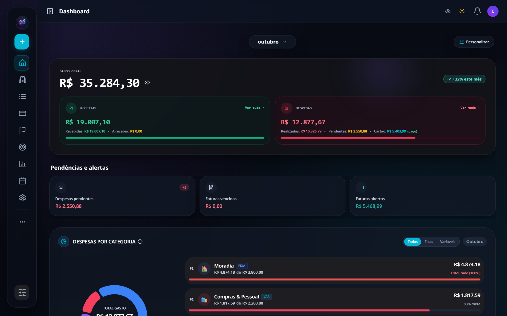
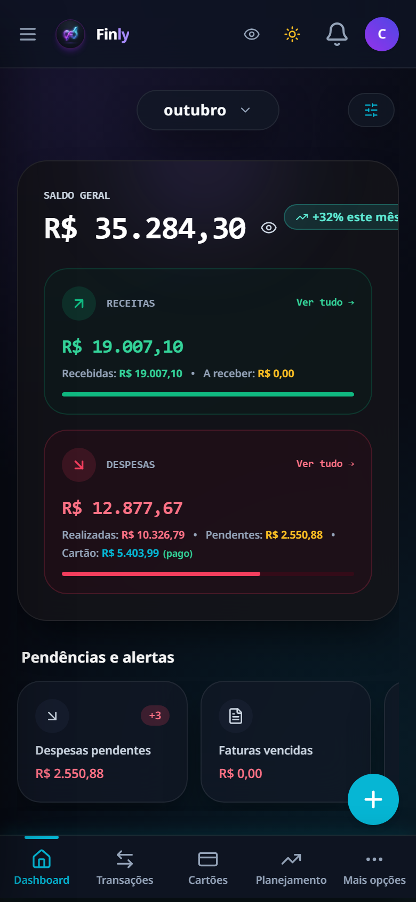
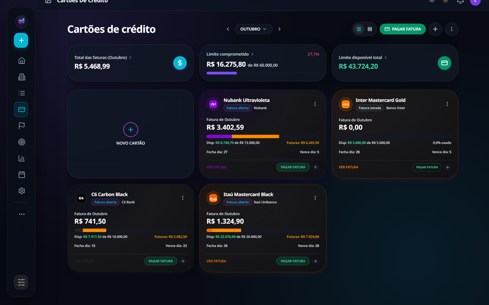
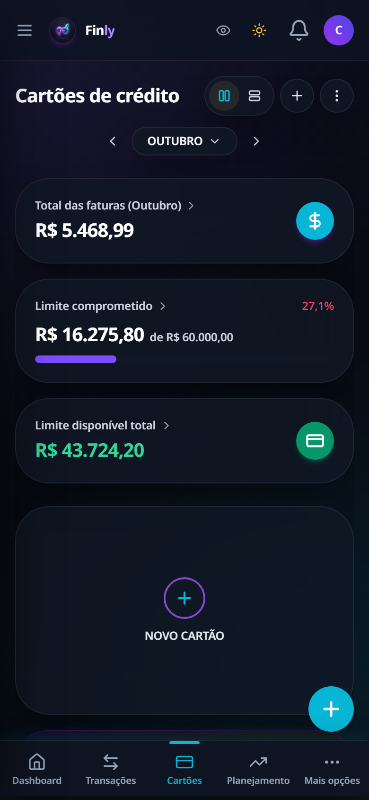
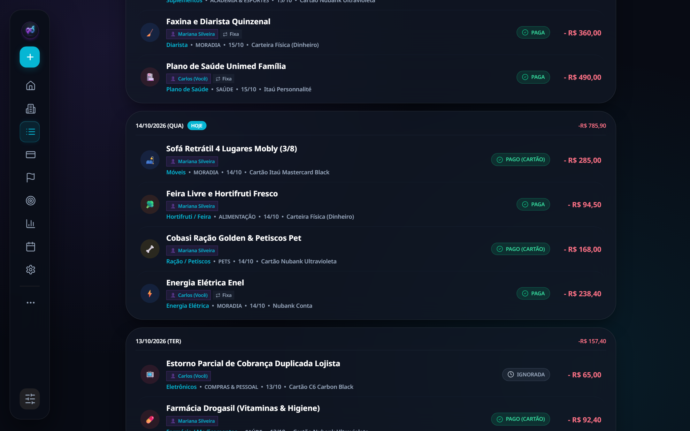
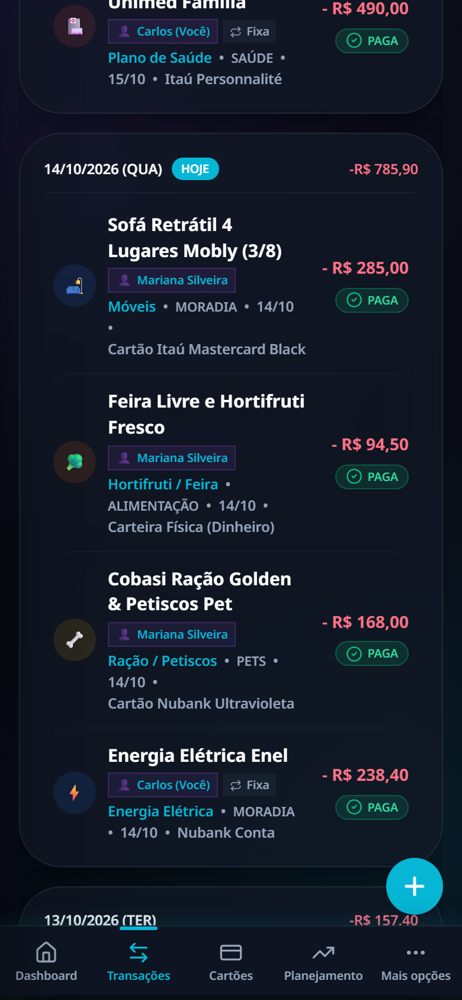
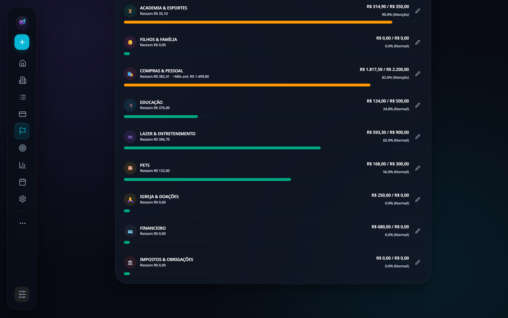
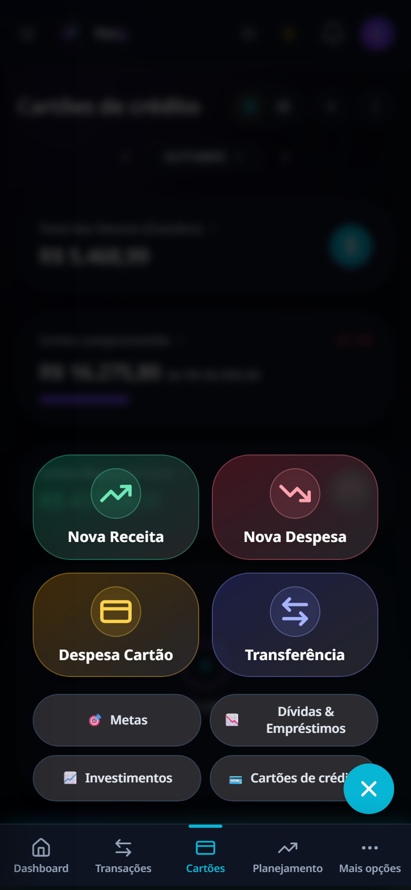
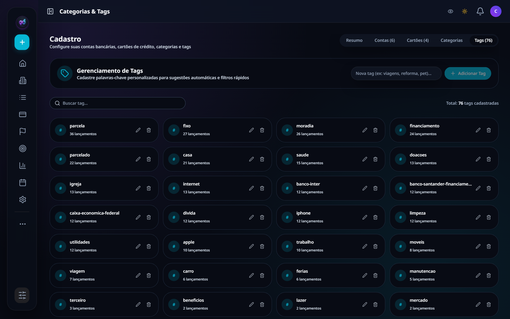
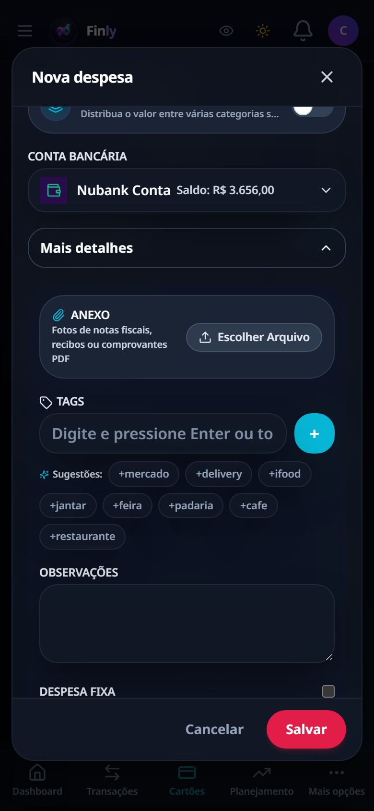

# 🚀 Finly `v1.1.83` (Web Bundle `v1.1.83.8`)

> Plataforma completa de gestão financeira pessoal, planejamento orçamentário, controle de faturas de cartões, fluxo de caixa, investimentos e inteligência analítica com paridade total Web e Mobile Android.

[](https://github.com/LivertonAguiar/Finly/actions/workflows/build-apk.yml)
[](package.json)
[](server/manifest.json)
[](CHANGELOG.md)

---

## 📑 Sumário

- [Visão Geral](#-visão-geral)
- [Galeria Visual (Web & Mobile)](#-galeria-visual-web--mobile)
- [Stack Tecnológica](#-stack-tecnológica)
- [Estrutura de Pastas e Arquitetura](#-estrutura-de-pastas-e-arquitetura)
- [Mapa Completo de Menus, Submenus e Caminhos](#-mapa-completo-de-menus-submenus-e-caminhos)
- [Tabela Geral de Rotas da Aplicação](#-tabela-geral-de-rotas-da-aplicação)
- [Recursos Recentes e Destaques](#-recursos-recentes-e-destaques)
- [Personalização Visual & Theme Engine](#-personalização-visual--theme-engine)
- [Motor de Internacionalização (i18n)](#-motor-de-internacionalização-i18n)
- [Instalação, Execução e Build](#-instalação-execução-e-build)
- [Guia de Deploy & Produção](#-guia-de-deploy--produção)
- [Arquitetura de Dados & Supabase](#-arquitetura-de-dados--supabase)
- [Changelog e Versões](#-changelog-e-versões)

---

## 🌟 Visão Geral

O **Finly** é um sistema financeiro moderno construído para altíssima performance, responsividade e robustez na Web e no aplicativo nativo Android. Combina controle transacional em tempo real, visualização de extratos bancários, previsão de fluxo de caixa, gestão de faturas de múltiplos cartões de crédito, amortização inteligente de financiamentos (SAC/Price), controle de patrimônio, central de ajuda com simulador interativo Android e persistência segura em nuvem com sincronização híbrida e suporte a atualizações instantâneas Over-The-Air (OTA).

---

## 📸 Galeria Visual (Web & Mobile)

O Finly foi concebido com foco total em **UX/UI premium**, alta densidade de informação e paridade completa entre a experiência Desktop (Web) e Mobile (Android).

| Tela / Módulo | Visão Desktop (Web) | Visão Mobile (Android) |
| :--- | :--- | :--- |
| **Dashboard Financeiro** |  |  |
| **Cartões & Faturas** |  |  |
| **Extrato & Lançamentos** |  |  |
| **Planejamento Orçamentário & Ações Rápidas** |  |  |
| **Cadastros de Tags & Modal Transacional** |  |  |

---

## 🗺️ Mapa Completo de Menus, Submenus e Caminhos

O Finly dispõe de navegação fluida adaptada à plataforma de uso:
- **Desktop**: Barra lateral expansível (`Sidebar`) customizável pelo usuário, agrupada por relevância (*Principal*, *Ferramentas*, *Gestão*).
- **Mobile**: Barra inferior fixa (`BottomNav`) com as 5 principais rotas + Botão de Ação Rápida Flutuante (`Speed Dial FAB`) + Hub centralizador (`MorePage`).

```text
FINLY NAVIGATION ARCHITECTURE
├── 🏠 1. Dashboard (/dashboard)
│   ├── Topo: Boas-vindas, Avatar do Perfil, Notificações, Seletor de Mês/Ano (Jan - Dez)
│   ├── Hero Card: Saldo Geral em Contas (Saldo Líquido Real) + Olho Ocultar Valores
│   ├── Twin Cards: Receitas (Recebidas vs A Receber) & Despesas (Realizadas vs Pendentes vs Cartão)
│   ├── Grid de 15 Bento Widgets (reordenáveis via Drag-and-Drop / Personalizáveis):
│   │   ├── Pendências e Alertas (Despesas pendentes, Faturas vencidas, Faturas abertas)
│   │   ├── Despesas por Categoria (Gráfico Donut com filtro Todas / Fixas / Variáveis)
│   │   ├── Autonomia de Reserva (Runway / Burn Rate em dias e data de esgotamento)
│   │   ├── Fluxo de Caixa Semestral (Barras comparativas de 6 meses)
│   │   ├── Resumo de Cartões (Limite disponível, faturas e vencimentos)
│   │   ├── Extrato de Lançamentos Recentes
│   │   └── Indicadores de Metas e Patrimônio
│
├── 🏛️ 2. Contas (/contas)
│   ├── Grid de Contas Bancárias & Carteiras (Saldo Real, Cor e Banco)
│   ├── Saldo Previsto por Conta (com projeção de lançamentos agendados)
│   ├── Inclusão/Exclusão da Conta no Saldo Geral
│   ├── Ações: Nova Conta, Editar Conta, Ajuste Rápido de Saldo e Exclusão
│   └── Extrato Filtrado Individual por Instituição
│
├── 📋 3. Transações (/transacoes)
│   ├── Barra Superior de Filtros: Tipo (Todas/Receitas/Despesas), Contas, Cartões, Categorias
│   ├── Seletor de Período (Mês Corrente, Intervalo Customizado, Ano)
│   ├── Alternador de Regime: "Por Competência/Fatura" vs "Por Data da Compra"
│   ├── Busca Textual Preditiva por Descrição, Tag ou Valor
│   ├── Timeline Diária Agrupada com Totais por Data
│   ├── Alternância Rápida de Status em 1 Toque (Pendente ⇄ Paga / Agendada)
│   └── Modal Detalhado de Transação:
│       ├── Edição de Valores, Datas (Data do Pagamento / Data de Vencimento)
│       ├── Gestão de Parcelas (X de Y) e Escopo de Alteração (Esta / Próximas / Todas)
│       ├── Divisão de Despesa por Múltiplas Categorias (Splits & Componentes)
│       ├── Marcação de Terceiros e Registro de Reembolso Parcial ou Integral
│       └── Upload de Anexos (Comprovantes / Recibos) e Lembretes Programados
│
├── 💳 4. Cartões de Crédito (/cartoes)
│   ├── Carrossel/Grid de Cartões Físicos e Virtuais com Bandeira e Cores
│   ├── Métricas de Cartão: Limite Total, Limite Comprometido e Limite Disponível
│   ├── Seletor de Mês da Fatura (Faturas Abertas, Fechadas e Pagas)
│   ├── Compras Parceladas atreladas ao cartão com contagem de parcelas restantes
│   ├── Modal de Quitação de Fatura com Seleção de Data Retroativa/Efetiva (`paidAt`)
│   └── Estorno Seguro de Pagamento de Fatura (Reabertura)
│
├── 🎯 5. Planejamento & Orçamento (/planejamento ou /orcamento)
│   ├── Wizard de Planejamento Mensal em 3 Etapas (`criarNovoPlanejamento`)
│   ├── Matriz Anual de Orçamento (12 meses com projeção e histórico)
│   ├── Definição de Teto de Gastos por Categoria
│   └── Acompanhamento de Aderência em Tempo Real com Barras Percentuais
│
├── 🚩 6. Metas & Objetivos (/metas)
│   ├── Categorias de Metas: Curto Prazo, Médio Prazo, Longo Prazo e Reserva de Emergência
│   ├── Configuração: Valor Alvo, Data Limite, Ícone e Cor
│   ├── Histórico de Aportes e Retiradas com Saldo Atual
│   └── Barra de Progresso com Porcentagem e Animação de Confetti ao completar
│
├── 📊 7. Relatórios & BI (/relatorios)
│   ├── Gráfico de Evolução Financeira (Receitas x Despesas x Saldo Líquido)
│   ├── Gráficos de Donut/Pizza para Composição de Despesas e Receitas
│   ├── Tabela Analítica de Distribuição por Categoria e Subcategoria
│   ├── Filtros Temporais (Mês, Trimestre, Semestre, Ano e Customizado)
│   └── Exportação Instantânea nos formatos Excel (.xlsx) e PDF
│
├── 📅 8. Calendário Financeiro (/calendario)
│   ├── Grid Mensal com Indicadores Semânticos de Vencimentos (Verde = Receita, Vermelho = Despesa)
│   ├── Resumo de Receitas e Despesas Previstas para o Mês Selecionado
│   └── Drawer Lateral Interativo ao clicar no dia: Extrato detalhado com baixa de status
│
├── 📉 9. Dívidas & Financiamentos (/dividas)
│   ├── Gestão de Empréstimos Pessoais, Consignados e Financiamentos Imobiliários
│   ├── Sistemas de Amortização Suportados: SAC e Tabela Price
│   ├── Breakdown Preciso de Parcelas: Amortização, Juros, Seguros (DFI/MIP) e Taxas Administrativas
│   ├── Amortização Extraordinária com Recálculo de Prazo ou Parcela
│   └── Sincronização Automática com o Extrato Diário do Finly
│
├── 📈 10. Investimentos & Patrimônio (/investimentos)
│   ├── Classes de Ativos: Renda Fixa (CDB/Tesouro), Ações, Fundos Imobiliários (FIIs), Criptomoedas
│   ├── Patrimônio Líquido Consolidado (`Net Worth`)
│   ├── Rendimento Mensal Acumulado e Histórico de Rentabilidade
│   └── Registro de Proventos e Aportes
│
├── 🤖 11. Assistente WhatsApp com IA (/whatsapp)
│   ├── Lançamento Inteligente de Despesas e Receitas via Conversa de WhatsApp
│   ├── Reconhecimento de Áudios de Voz via Transcrição
│   ├── Leitura e OCR de Fotos de Cupons Fiscais e Comprovantes
│   └── Confirmação e Conciliação Automática no App
│
├── ✨ 12. Skills Financeiras de IA (/skills)
│   ├── Otimizador de Milhas e Programas de Fidelidade
│   ├── Rastreador de Assinaturas e Recorrências Esquecidas
│   └── Auditoria Tributária e Dicas de Redução de Gastos Fixos
│
├── 🗂️ 13. Categorias & Tags (/cadastro)
│   ├── Gestão de Categorias Pai (Receitas e Despesas) com Paleta Hexadecimal e Ícones
│   ├── Árvore de Subcategorias com Configuração Analítica
│   └── Painel Centralizado de Tags: Grid de tags com contagem de uso, renomeação e exclusão em lote
│
├── 👥 14. Finanças da Família (/familia)
│   ├── Compartilhamento de Finanças Multiusuário
│   ├── Perfis de Acesso: Titular (Admin) e Dependentes
│   └── Filtro de Lançamentos e Gastos por Membro Familiar
│
├── ⚙️ 15. Configurações (/settings)
│   ├── Sub-aba 1: Perfil (Nome, E-mail, Telefone, Avatar e Moeda Oficial BRL/USD/EUR)
│   ├── Sub-aba 2: Aparência & Tema:
│   │   ├── 10 Presets (Sleek Obsidian, Swiss Navy, Tech Green, Emerald Slate, Clean Light, etc.)
│   │   ├── 6 Cores de Acento Primário (Púrpura, Verde, Azul, Laranja, Rosa, Vermelho)
│   │   └── 3 Raio de Bordas (Ultra-Redondo 25px, Moderno 16px, Reto 8px)
│   ├── Sub-aba 3: Notificações & Alarmes (Lembretes com antecedência e integração AlarmManager)
│   ├── Sub-aba 4: Segurança (Bloqueio por PIN de 4 dígitos, Biometria e PBKDF2)
│   └── Sub-aba 5: Dados & Backup (Backup em JSON/ZIP, Importação com mesclagem e Zona de Perigo)
│
├── 💡 16. Central de Ajuda (/ajuda)
│   ├── Base de Conhecimento com Tutoriais Passo a Passo
│   ├── FAQ Interativo e Dúvidas Frequentes
│   └── Finly Web Mockup: Simulador Visual Interativo com Tela de Celular Android
│
└── ➕ 17. Mais Opções & Sobre (/mais ou /sobre)
    ├── Sub-aba Geral: Hub de Acesso Rápido a todos os módulos secundários
    └── Sub-aba Sobre:
        ├── Exibição da Versão Nativa do APK instalada
        ├── Exibição da Versão do Pacote Web OTA ativo
        ├── Botão "Verificar Atualizações"
        ├── Botão Permanente "Baixar APK Nativo Android"
        └── Histórico Completo de Versões e Changelog
```

---

## 🧭 Tabela Geral de Rotas da Aplicação

| Rota URL | Componente Principal | Categoria | Descrição Principal |
| :--- | :--- | :--- | :--- |
| `/dashboard` | `DashboardPage` | Principal | Visão geral dos saldos, indicadores e 15 widgets modulares. |
| `/contas` | `AccountsPage` | Principal | Saldos bancários, carteiras em dinheiro e extrato individual. |
| `/transacoes` | `TransactionsPage` | Principal | Extrato completo, timeline cronológica e filtros avançados. |
| `/cartoes` | `CreditTab` | Principal | Gestão de faturas, limites e compras parceladas no crédito. |
| `/planejamento` | `BudgetPage` | Principal | Orçamento mensal, metas por categoria e matriz 12 meses. |
| `/orcamento` | `BudgetPage` | Principal | Alias direto da rota de planejamento orçamentário. |
| `/metas` | `GoalsPage` | Principal | Metas de curto/longo prazo e comemoração de conclusão. |
| `/relatorios` | `ReportsPage` | Principal | BI visual, gráficos donut/evolução e exportação XLSX/PDF. |
| `/calendario` | `CalendarPage` | Principal | Grade mensal com marcações e drawer lateral de lançamentos. |
| `/dividas` | `DebtsPage` | Ferramentas | Controle de dívidas, financiamentos (SAC/Price) e amortização. |
| `/investimentos` | `InvestmentsTab` | Ferramentas | Renda fixa, fundos, ações, proventos e patrimônio líquido. |
| `/whatsapp` | `WhatsAppPage` | Ferramentas | Assistente virtual de IA para lançamentos via WhatsApp. |
| `/skills` | `FinancialSkillsPage` | Ferramentas | Skills de IA (auditoria de custos, milhas e otimização). |
| `/cadastro` | `CadastrosPage` | Gestão | Gerenciador de Categorias, Subcategorias e Painel de Tags. |
| `/familia` | `FamilyPage` | Gestão | Finanças compartilhadas com múltiplos membros familiares. |
| `/settings` | `SettingsPage` | Gestão | Perfil, Temas (10 presets), Notificações, PIN e Backup. |
| `/perfil` | `ProfilePage` | Gestão | Visualização de dados cadastrais e segurança da conta. |
| `/ajuda` | `HelpCenterPage` | Gestão | Central de tutoriais e Simulador Web Mockup do Finly. |
| `/mais` | `MorePage` | Navegação | Hub mobile com atalhos gerais e aba Sobre/Download de APK. |
| `/sobre` | `MorePage` (subtab SOBRE) | Navegação | Informações de versão, status OTA e changelog interativo. |

---

## ✨ Recursos Recentes e Destaques

### 🔒 Proteção de Despesas Futuras & Saldo em Contas (v1.1.83.8)
- **Não Comprometimento de Saldo Antecipado**: Despesas recorrentes e parcelas em meses futuros nascem estritamente como `scheduled` (agendadas), garantindo que o **Saldo Geral em Contas** reflita exclusivamente valores já liquidados e pagos.
- **Alternância Segura de Status**: Ao desmarcar uma despesa futura paga por engano, o sistema reverte com inteligência para `scheduled` (evitando ficar como pendente vencida).
- **Hero Card Focado em Liquidez**: Exibição prioritária do Saldo Real Disponível em Contas, com pílulas informativas de taxa de poupança ou consumo econômico do mês.

### 🗓️ Seletor de Meses à Prova de Overflow (v1.1.83.5)
- **Ancoragem Determinística no Dia 1**: Resolução do bug de overflow em meses de 30/31 dias (ex: selecionar Novembro no dia 31 de Outubro não pula mais para Dezembro).

### 📱 Múltiplos Tamanhos de Widgets Nativos para Android (v1.1.83)
- **3 Opções no Launcher Android**:
  - **Bento Dashboard (4x2 / 4x3)**: Saldo em Contas, Resultado do Mês, Fatura e botões rápidos (+ Despesa, + Receita).
  - **Barra Compacta (4x1)**: Resumo horizontal elegante para o topo da tela inicial.
  - **Mini Resumo (2x2)**: Card quadrado compacto com métricas essenciais.
- **AlarmManager com allowWhileIdle**: Notificações sonoras e alertas que disparam pontualmente mesmo com o aparelho em repouso profundo (*Doze Mode*) ou app fechado.

### ⚡ Atualizações Over-The-Air (Live Update OTA)
- **Distribuição Instantânea**: Atualização do frontend React sem necessidade de reinstalar o APK Android.
- **Proteção Anti-Rollback e Guardas de Inicialização**: Verificação rigorosa de SHA-256 e teste de integridade antes de confirmar o novo pacote ativo.

---

## 🛠️ Stack Tecnológica

| Camada | Tecnologia | Descrição |
| :--- | :--- | :--- |
| **Frontend Framework** | **React 18** (TypeScript) | Interface declarativa com tipagem estrita |
| **Mobile Runtime** | **Capacitor 8** (Android) | Empacotamento nativo Android com suporte a hardware back button e safe-area |
| **Build & Bundler** | **Vite 5** | Compilação ultra-rápida e empacotamento modular de bundles |
| **Estilização** | **Tailwind CSS + CSS Variables** | Design responsivo com motor de temas dinâmico |
| **Banco de Dados & Nuvem** | **Supabase (PostgreSQL + RLS)** | Banco relacional na nuvem com isolamento estrito via Row Level Security |
| **Ícones** | **Lucide React** | Conjunto completo de ícones minimalistas |
| **Efeitos Visuais** | **Canvas Confetti** | Animações de metas e marcos financeiros |
| **Roteamento** | **HTML5 History API** | Sincronização em tempo real da URL (`/dashboard`, `/contas`, etc.) |
| **Backend API & Sync** | **Node.js / Express** | Serviço de sincronização multi-usuário, manifesto OTA e envio de relatórios |
| **Internacionalização** | **i18n Custom Engine** | Suporte a pt-BR, en-US e es-ES + multi-moedas |

---

## 🎨 Personalização Visual & Theme Engine

O sistema possui um motor dinâmico em `src/utils/themeEngine.ts` que manipula o DOM instantaneamente:

### 1. Presets de Temas (10 Presets Integrados)
* **`sleek-obsidian`**: Fundo `#07080A` com cartões em `#14151B` e acento Âmbar Solar.
* **`sleek-neo-glass`**: Fundo translúcido `#080B14` com cartões `#121826` e Ciano Neon.
* **`tech-green`**: Fundo terminal `#0A0D0C` com cartões `#121714` e Verde Matrix.
* **`swiss-navy`**: Fundo nobre `#071026` com cartões `#0D1B3E` e Dourado Champanhe.
* **`linear-mono`**: Monocromático de alto contraste puro em preto absoluto `#000000`.
* **`finly-dark`**: Fundo `#121214` com cartões em `#18181B` e Púrpura Finly Oficial.
* **`finly-deep-dark`**: Fundo `#121214` com contraste profundo e cartões `#18181B`.
* **`midnight-oled`**: Preto absoluto `#000000` com cartões `#101012` para economia máxima em OLED.
* **`emerald-slate`**: Azul petróleo marinho `#0F172A` com cartões `#1E293B` e Verde Esmeralda.
* **`clean-light`**: Branco puro minimalista `#F8FAFC` com cartões `#FFFFFF` e Azul Celeste.

### 2. Paleta de Cores de Acento (`--primary-accent`)
* 🟣 **Púrpura / Indigo** (`#7C4DFF`)
* 🟢 **Verde Esmeralda** (`#00A884`)
* 🔵 **Azul Elétrico** (`#0091FF`)
* 🟠 **Laranja Solar** (`#FF8A00`)
* 🌸 **Rosa Neon** (`#EC4899`)
* 🔴 **Vermelho Carmim** (`#EF4444`)

---

## 🌍 Motor de Internacionalização (i18n)

* **Idiomas Suportados**:
  * 🇧🇷 Português (Brasil) - `pt-BR`
  * 🇺🇸 English (United States) - `en-US`
  * 🇪🇸 Español (España / Latam) - `es-ES`
* **Formatação Monetária**:
  * `BRL` (R$ 1.250,00)
  * `USD` ($1,250.00)
  * `EUR` (€1.250,00)

---

## ⚙️ Instalação, Execução e Build

```bash
# 1. Instalar dependências
npm install

# 2. Iniciar servidor de desenvolvimento Vite
npm run dev

# 3. Compilar para produção Web
npm run build

# 4. Executar testes de transações e regras de negócio
npm run test:transactions

# 5. Sincronizar com Android (Capacitor)
npm run cap:sync

# 6. Abrir no Android Studio
npm run cap:open
```

### Serviço Backend API (`server/apiServer.js`):
```bash
npm run server
```

---

## 🚀 Guia de Deploy & Produção

### 1. Deploy Live Update OTA na VPS:
Para atualizar o frontend instantaneamente em produção:
```powershell
powershell -ExecutionPolicy Bypass -File .\scripts\deploy-web-ota.ps1 -WebVersion "1.1.83.X" -Notes "Descrição da release"
```

### 2. Deploy Completo de Containers na VPS (Docker):
```powershell
powershell -ExecutionPolicy Bypass -File .\scripts\deploy-vps.ps1
```

### 3. CI/CD no GitHub Actions (Android APK Release):
A cada push na branch `main`:
- O GitHub Actions compila o bundle Web e os testes unitários.
- Gera o binário nativo assinado `finly-vX.X.XX.apk`.
- Cria a release oficial no GitHub com download público direto.

---

## 📋 Changelog e Versões

Consulte o arquivo [`CHANGELOG.md`](CHANGELOG.md) para o histórico completo de novidades e versões.
